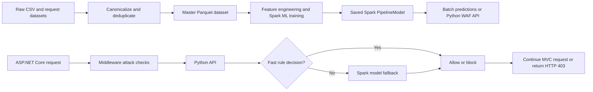

# PySpark Web Application Firewall

A hybrid Web Application Firewall (WAF) prototype that classifies HTTP requests using a PySpark machine-learning pipeline and deterministic security rules. The repository includes data preparation and model evaluation tools, a small Python inspection API, and an ASP.NET Core event-booking website that demonstrates request blocking in an application workflow.

This is an educational and experimental project, not a production-ready security appliance. The model runs with Spark's local master (`local[*]`); the project does not deploy a distributed Spark cluster or sit in front of arbitrary production traffic.

## What It Does

- Combines labeled HTTP request datasets into a canonical, deduplicated master dataset.
- Trains a binary normal-versus-malicious classifier with Spark ML.
- Uses request structure, security indicators, benign form signals, and hashed request text as model features.
- Applies high-confidence attack rules and narrowly scoped safe-traffic overrides around the model's probability threshold.
- Scores individual requests from log files or CSV, and exposes the same decision flow over a local JSON API.
- Demonstrates allow/block decisions in an ASP.NET Core MVC event-booking application.
- Produces evaluation metrics, threshold comparisons, false-positive and false-negative examples, and dataset metadata.

The main attack patterns explicitly represented in the feature and rule logic include SQL injection, cross-site scripting (XSS), command injection, path traversal, and server-side template injection (SSTI). The custom-data templates also include file-inclusion, redirect, and server-side request forgery (SSRF) categories. Detection quality depends on the available labeled examples and is not guaranteed for every attack or encoding.

## System Flow



## How The Detector Works

### Data preparation

`src/build_master_dataset.py` reads supported files from `data_raw/`, parses their differing request formats, normalizes request lines and line endings, and combines request bodies with their HTTP request lines. Labels are binary: `0` is normal and `1` is malicious. Unless `--keep-duplicates` is supplied, duplicate `(request, label)` pairs are removed. The output is a Spark Parquet dataset plus metadata and a small CSV sample.

The checked-in metadata records 25,685 canonical rows: 16,011 malicious and 9,674 normal. It records `dataset1`, `dataset2`, and `custom_dataset` as included sources. Some input sources can be excluded when they are exact duplicates after canonicalization; see `data_processed/master_dataset_metadata.json` for the recorded build details.

The `making custom data/` directory contains payload text files, request templates, and `make.py`, which generates the custom labeled CSV in `data_raw/custom_dataset.csv`.

### Feature engineering and classification

`src/train_pipeline.py` builds and saves a Spark ML `PipelineModel`. Its pipeline:

1. Extracts the lowercased request, method, target, path, query, and body.
2. Derives numeric and boolean signals such as request length, suspicious-character counts, URL encoding, attack-pattern matches, request shape, and form-field characteristics.
3. Tokenizes request text with `RegexTokenizer`, converts tokens with binary `HashingTF` (8,192 features by default), and weights them with `IDF`.
4. Assembles engineered and text features and fits Spark ML Logistic Regression with class weights.
5. Applies rule overrides and a configurable malicious-probability threshold (default `0.70`).

High-confidence attack rules take precedence over the model. Strict safe-request overrides are limited to recognized clean GET patterns and form shapes/endpoints; they are intended to reduce false positives on normal application traffic, not to declare arbitrary inputs safe.

### Live request inspection

`src/waf_api.py` serves `POST /check` and `GET /health` on `127.0.0.1:8765` by default. It checks obvious attack patterns first and can quickly allow certain clean GET or form requests. It loads the Spark model lazily only when a request needs the ML fallback. API decisions include the predicted label, malicious probability, reason, threshold, whether the model was used, and the final `allow` or `block` action.

The MVC app's `WafInspectionMiddleware` inspects GET and POST requests, excluding static assets. It serializes form values for inspection and omits framework fields whose names start with `__`. A local high-confidence attack check runs before calling the Python API. A malicious decision returns HTTP `403`; otherwise the request continues to its MVC action. The last decision is also stored in session and diagnostic response headers are added.

The WAF API is an unauthenticated local demo service and currently enables wildcard CORS. Keep it bound to loopback and do not expose it directly to the internet.

## Technologies

- **Python 3.11+** for data preparation, training, evaluation, batch prediction, and the API.
- **Apache Spark / PySpark 4.1.1** and **Py4J 0.10.9.9** for distributed-data APIs, feature processing, and Spark ML. The scripts currently use local execution.
- **Java JDK 17+** as the Spark runtime prerequisite.
- **ASP.NET Core MVC targeting .NET 10** for the demo website.
- **Entity Framework Core 10** with the SQL Server provider for the demo application's database.
- **CSV, JSON Lines, and Parquet** for input, staging, reports, and processed data.

Python package versions are pinned in [requirements.txt](requirements.txt).

## Repository Layout

| Path | Purpose |
| --- | --- |
| `src/build_master_dataset.py` | Parse, normalize, combine, and deduplicate source datasets. |
| `src/train_pipeline.py` | Engineer features, train the classifier, evaluate the split, and save the model. |
| `src/evaluate_pipeline.py` | Evaluate a saved model and write threshold and error-analysis reports. |
| `src/run_prediction.py` | Parse unseen request logs or CSV and export predictions. |
| `src/predict_unseen.py` | Convenience entry point for unseen-request prediction. |
| `src/waf_api.py` | Local HTTP API for online request inspection. |
| `data_raw/` | Raw datasets, including the generated custom dataset. |
| `data_processed/` | Built Parquet dataset, sample export, and build metadata. |
| `model/waf_detection_pipeline/` | Saved Spark ML pipeline model. |
| `making custom data/` | Attack templates, payload lists, and custom dataset generator. |
| `reports/evaluation/` | Saved metrics, threshold comparisons, and error-analysis CSVs. |
| `demo_website/SmartEventMVC_WAF_Demo/SmartEventMVC/` | ASP.NET Core MVC demo and WAF integration. |
| `demo_files/` | Unseen-request examples and demo assets. |
| `requirements.txt` | Pinned Python dependencies. |

## Requirements And Setup

Install Python 3.11 or newer, Java JDK 17 or newer, and (for the website demo) the .NET 10 SDK. The MVC app also requires a reachable SQL Server database compatible with `SmartEventDbContext`.

Create the Python environment from the repository root:

```bash
python -m venv .venv
source .venv/bin/activate
python -m pip install -r requirements.txt
```

On Windows PowerShell, activate the environment with `.venv\Scripts\Activate.ps1` instead.

### Build, train, and evaluate

Run these commands from the repository root. Dataset building and training are needed when you want to regenerate the checked-in artifacts or use a newly generated dataset.

```bash
python src/build_master_dataset.py
python src/train_pipeline.py
python src/evaluate_pipeline.py
```

The dataset builder writes `data_processed/master_dataset/` and `data_processed/master_dataset_metadata.json`. Training saves `model/waf_detection_pipeline/` and training metrics under `reports/evaluation/`. Evaluation writes further metrics, threshold comparisons, and misclassification analyses to the same report directory. Spark writes some outputs as directories containing part files rather than as single files.

Useful options are available on the scripts with `--help`. For example, the builder supports `--keep-duplicates`; the trainer and evaluator support `--seed` and `--prediction-threshold`; the trainer also exposes `--max-iter` and `--num-features`.

### Predict from unseen requests

The default input is `demo_files/new_unseen_logs.log`. To specify another text log or a CSV with a `request` column:

```bash
python src/predict_unseen.py --input-path demo_files/new_unseen_logs.log
python src/predict_unseen.py --input-path path/to/requests.csv --output-name my_predictions
```

The output is written to `demo_files/<output-name>/predictions.csv`. Each result includes the request, prediction (`0` normal, `1` malicious), malicious probability, rule signals, and decision reason. Use `--prediction-threshold` to override the default `0.70` threshold.

### Run the Python API

Start the API from the repository root after a model has been trained or provided:

```bash
python src/waf_api.py
```

Check that it is listening:

```bash
curl http://127.0.0.1:8765/health
```

Send a request for inspection:

```bash
curl -X POST http://127.0.0.1:8765/check \
	-H 'Content-Type: application/json' \
	-d '{"method":"GET","path":"/Events","queryString":"searchString=music"}'
```

The API also accepts a `rawRequest` string. Its request components are `method`, `path`, `queryString`, `body`, and optional `threshold`; both camelCase and PascalCase field names are accepted.

### Run the MVC demo

Start the Python API in one terminal, then run the website from another:

```bash
cd demo_website/SmartEventMVC_WAF_Demo/SmartEventMVC
dotnet restore
dotnet run
```

The launch profile serves HTTP at [http://localhost:5284](http://localhost:5284) (and HTTPS at `https://localhost:7230`). The demo includes event browsing and booking flows, members, inquiries, and reviews.

**Database setup is machine-specific.** The checked-in `appsettings.json` and `Models/SmartEventDbContext.cs` contain a SQL Server Express connection string for the original development machine. Configure both for a SQL Server instance and database/schema available in your environment before using database-backed website features. The repository does not include portable database provisioning. The Python data and model pipeline can be run independently of this website database.

WAF behavior is configured in the `Waf` section of `appsettings.json`: API URL, whether inspection is enabled, GET/POST inspection, request timeout, fail-open behavior, and prediction threshold. `FailOpen` is currently `true`, so if the API is unavailable the website allows the request to continue and records that state. Change this deliberately for any controlled test; fail-open is not an appropriate default for every deployment.

## Evaluation Snapshot

The checked-in evaluation reports the following results at threshold `0.70`:

| Metric | Recorded value |
| --- | ---: |
| Accuracy | 98.34% |
| Weighted precision | 98.39% |
| Weighted recall | 98.34% |
| F1 score | 98.34% |
| Area under ROC | 0.9987 |
| Area under precision-recall curve | 0.9990 |
| False positives | 7 |
| False negatives | 80 |

These are saved experiment results, not a guarantee of real-world protection. There is also a count mismatch in the checked-in artifacts: the confusion-matrix entries sum to 5,238 while the reports' `test_rows` field says 4,977. Re-run training/evaluation and verify the resulting reports before using these figures in a formal benchmark or submission. The current random train/test split does not establish generalization to independently collected traffic or unseen attack families.

## Limitations And Safe Use

- This is a prototype for experimentation and demonstration. It is not a replacement for a maintained WAF, secure application design, input validation, parameterized database access, or security testing.
- The Python API uses the standard-library HTTP server, has no authentication, and returns detailed decision data. Keep it on loopback or place it behind appropriate access controls before any broader testing.
- The MVC demo is configured to fail open by default. An unavailable API can therefore mean requests proceed without model inspection.
- Regex rules and learned features are dataset-dependent. False positives, false negatives, encoding edge cases, and distribution shift are expected risks.
- The saved evaluation split is random and the checked-in report has the count inconsistency described above.
- The MVC app contains a development-machine SQL Server connection string; configure the database before running database-backed flows.

Generated environments and build outputs such as `.venv/`, `bin/`, `obj/`, Python caches, and Spark staging files are excluded from version control. See `.gitignore` for the current exclusions.
